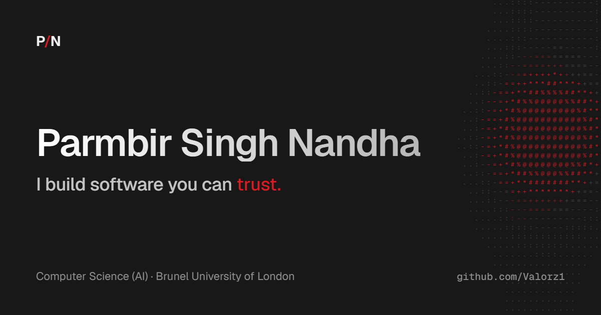

<div align="center">



# Parmbir Nandha — Portfolio

**Cybersecurity · Software Engineering · Applied AI**

A personal portfolio showcasing projects, technical skills, industry experience and the things I'm building next.

[](https://developer.mozilla.org/en-US/docs/Web/HTML)
[](https://tailwindcss.com/)
[](https://developer.mozilla.org/en-US/docs/Web/JavaScript)
[](LICENSE)

[Projects](#featured-work) · [How to run](#run-locally) · [Get in touch](#contact)

</div>

---

## About

I'm **Parmbir Singh Nandha**, a second-year **BSc Computer Science (AI)** student at **Brunel University of London**. I build practical software with a particular interest in cybersecurity, backend development and local-first AI.

This website brings my work into one place, including security tools, retrieval-augmented generation (RAG) applications, robotics and community projects. It also highlights my information security experience on the **HS2 London Tunnels** project.

I'm seeking a **12-month placement in 2027**, with interests spanning cybersecurity, software engineering and AI/data roles.

## Website features

- **Responsive, single-page layout** with mobile navigation.
- **Dark and light modes** with a saved theme preference.
- **Filterable project cards** covering security, AI, backend, Java and design.
- **Interactive details** including a terminal-style hero, scroll progress, animations and hover effects.
- **Accessibility considerations** including semantic markup, visible keyboard focus, a skip link and reduced-motion handling.
- **Social sharing metadata** and a custom `404.html` page.

The design uses a **ruby, charcoal and silver** palette with Geist and Geist Mono typography.

## Featured work

These projects are **showcased by this website**; they are not all implemented inside this repository.

| Project | Focus | Link |
| --- | --- | --- |
| **HookLine** | Python phishing email analysis, authentication checks and suspicious-link investigation | [Source](https://github.com/Valorz1/hookline) |
| **NetValor** | UK-focused financial education with a RAG-powered assistant; under development | [Source](https://github.com/Valorz1/NetValor) |
| **The Archive** | Local-first document Q&A with citations using LlamaIndex, ChromaDB and Ollama | [Source](https://github.com/Valorz1/rag-chatbot) |
| **UK Tick Tracker** | FastAPI backend for cleaned tick-sighting data, filtering and reporting | [Source](https://github.com/Valorz1/uk-tick-tracker-backend) |
| **Hillingdon ReportHub** | Hackathon-built council issue reporting and triage; recognised by Microsoft | [Source](https://github.com/Valorz1/Hillingdon-ReportHub) |
| **Spybot** | Java-based Raspberry Pi SwiftBot project with Morse-code messaging | Featured on the website |
| **Brunel Cyber Security Society** | Website design and committee collaboration | [Visit site](https://brunelcs.org) |

There are more projects and details in the **Work** section of the portfolio.

## Built with

This portfolio is a **static website**—it is not a React or Next.js app and it doesn't require a backend.

| Technology | Purpose |
| --- | --- |
| **HTML5** | Page structure and content |
| **Tailwind CSS v3** | Utility styling, compiled to `assets/tailwind.css` |
| **Custom CSS** | Theme tokens, transitions and visual details |
| **Vanilla JavaScript** | Theme toggle, navigation, filtering, scroll effects and interactions |
| **Geist / Geist Mono** | Typography via Google Fonts |
| **Phosphor Icons** | Interface icons via CDN |

## Run locally

Clone the repository:

```bash
git clone https://github.com/Valorz1/my-portfolio.git
cd my-portfolio
```

The compiled stylesheet is already included, so **no build step is required just to view the site**. Open `index.html` in a browser, or serve it locally:

```bash
python -m http.server 8000
```

Then visit **http://localhost:8000**.

### Making style changes

If you modify the Tailwind classes in the HTML or the source stylesheet, regenerate the compiled CSS using Node.js and npm:

```bash
npm run build:css
```

The script uses Tailwind CSS 3.4.16 through `npx`, reads `src/input.css` and writes the minified result to `assets/tailwind.css`.

## Project structure

```text
my-portfolio/
├── index.html             # Main portfolio and JavaScript interactions
├── 404.html               # Custom not-found page
├── assets/
│   ├── og-image.png       # Social sharing / preview image
│   ├── projects/          # Project screenshots
│   └── tailwind.css       # Compiled Tailwind styles
├── src/
│   └── input.css          # Tailwind CSS entry point
├── tailwind.config.js     # Theme extensions and content paths
├── package.json          # CSS build script
└── LICENSE               # MIT License
```

## Deployment

Because this is a static site, it can be hosted on **GitHub Pages**, Netlify, Vercel or another static-file host. Publish the repository root so `index.html` and the `assets/` directory are served together.

Before publishing, update the Open Graph image URL in `index.html` to an **absolute public URL** so link previews work consistently.

## Contact

- **GitHub:** [@Valorz1](https://github.com/Valorz1)
- **LinkedIn:** [Parmbir Nandha](https://www.linkedin.com/in/parmbir-nandha-940987315/)
- **Email:** [nparmbir1@gmail.com](mailto:nparmbir1@gmail.com)

---

<div align="center">
  <sub>Designed and developed by Parmbir Singh Nandha · Licensed under the <a href="LICENSE">MIT License</a></sub>
</div>
